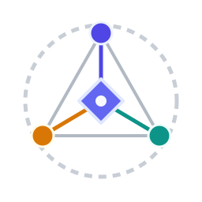

<div align="center">
  
  <h1>Persona Skills（人物思想推演库）</h1>
  <p>将思想者与创始人的底层公理、推理算法与认知盲区沉淀为可执行的 Agent Skills，用于个人深度思考、决策推演与观点压力测试。</p>
  <p>License: <a href="./LICENSE">MIT</a> · 兼容 Antigravity Skill / Plugin 规范</p>
</div>

---

与追求“语气像不像”的娱乐角色扮演 Prompt 不同，本仓库把每一位人物的**底层世界观公理、价值排序、可执行推理步骤、一手核实语料与固有认知盲区**拆解为结构化的 Skill，让 AI 成为帮你照见盲区、检验逻辑的“可运行思维操作系统”。

---

## 为什么不是普通角色扮演？同一个问题，三种不同推演逻辑

面对“**手头同时铺开多件事、精力分散且不知该不该跳出舒适区**”这同一个问题，仓库中三位人物会从完全不同的底层公理切入：

| 视角 | 核心切入公理 | 先拷问什么 | 倾向的动作 | 必附的视角盲区 |
| :--- | :--- | :--- | :--- | :--- |
| **张一鸣**（`zhang-yiming`） | 一手事实、延迟满足、全局最优、平常心 | 哪部分只是路径依赖？你拿到了什么一手反馈？ | 去抽象、搭最小可验证闭环、保持高信息密度输入 | 易低估当下生活节奏与非量化情绪损耗 |
| **黄仁勋**（`jensen-huang`） | 物理光速基准、零亿美元市场、战略撤退、低预期韧性 | 你是在红海里硬卷，还是在卡位新空白？今天必须放弃哪条支线？ | 果断战略撤退砍支线、定义早期领先指标（EIoFS）、死磕全栈痛点 | 若无稳定现金流底座，长期零反馈押注易耗尽窗口 |
| **埃隆·马斯克**（`elon-musk`） | 物理是法律、白痴指数、五步算法（删减先于优化） | 你的工作流里有多少“白痴摩擦”？哪些需求压根不该存在？ | 先暴力砍掉 30%–50% 冗余步骤、最后再谈自动化 | 暴力删减法若套用于人际信任与品牌生态易造成不可逆损伤 |

---

## 目录结构

```text
persona-skills/
├── LICENSE                             # MIT 开源协议
├── README.md                           # 仓库说明、使用指南与免责声明
├── CONTRIBUTING.md                     # 新增人物规范与四条质量红线
├── plugin.json                         # Antigravity Plugin 清单
├── .gitignore                          # 忽略临时文件及本地隐私笔记/密钥
├── assets/
│   └── logo.svg                        # 仓库与 Plugin 图标
├── .agents/
│   └── skills.json                     # 在本仓库目录内自动发现 skills/
├── rules/
│   └── AGENTS.md                       # 推演纪律（史实与外推分离、禁止谄媚、必附盲区）
├── templates/
│   └── persona-skill-template.md       # 新增人物 Skill 的标准模板
└── skills/
    ├── persona-distiller/              # 【元技能】从一手语料提炼新的人物 Skill
    │   ├── SKILL.md
    │   └── resources/
    │       └── persona-skill-template.md
    ├── persona-council/                # 【元技能】调度多视角独立推演与圆桌交锋
    │   └── SKILL.md
    ├── elon-musk/                      # 【人物技能】埃隆·马斯克思想推演系统
    │   ├── SKILL.md
    │   ├── references/
    │   │   ├── mental-models.md        # 演进阶段、10 个核心思维模型与盲区剖析
    │   │   ├── quotes.md               # 带出处的已核实一手原话库
    │   │   └── cases.md                # 5 个真实决策、修正与跨界边界案例
    │   └── examples/
    │       └── calibration-qa.md       # 标定问答（用于校验推演是否跑偏）
    ├── jensen-huang/                   # 【人物技能】黄仁勋思想推演系统
    │   ├── SKILL.md
    │   ├── references/
    │   │   ├── mental-models.md        # 演进阶段、10 个核心思维模型与盲区剖析
    │   │   ├── quotes.md               # 带出处的已核实一手原话库
    │   │   └── cases.md                # 5 个真实决策、撤退与败局案例
    │   └── examples/
    │       └── calibration-qa.md       # 标定问答（用于校验推演是否跑偏）
    └── zhang-yiming/                   # 【人物技能】张一鸣思想推演系统
        ├── SKILL.md
        ├── references/
        │   ├── mental-models.md        # 演进阶段、10 个核心思维模型与盲区剖析
        │   ├── quotes.md               # 带出处的已核实一手原话库
        │   └── cases.md                # 5 个关键真实决策与反思案例
        └── examples/
            └── calibration-qa.md       # 标定问答（用于校验推演是否跑偏）
```

---

## 已收录人物索引

| Skill ID | 人物 | 核心思想范式 | 最适合推演的问题类型 | 入口 |
| :--- | :--- | :--- | :--- | :--- |
| `zhang-yiming` | 张一鸣 | 工程师底色的务实浪漫、系统优化、延迟满足、Context not Control、平常心 | 个人长期职业/成长决策、项目/想法压力测试、组织机制与信息流设计、去抽象纠偏 | [SKILL.md](./skills/zhang-yiming/SKILL.md) |
| `jensen-huang` | 黄仁勋 | 物理第一性原理（光速基准）、零亿美元市场、战略撤退、低预期强韧性、全栈协同与任务即老板 | 技术/职业长周期押注、沉没成本战略撤退、红海路线纠偏、抗压韧性测试与一线卡点排查 | [SKILL.md](./skills/jensen-huang/SKILL.md) |
| `elon-musk` | 埃隆·马斯克 | 物理学第一性原理、白痴指数、五步工程算法（删减先于优化、自动化最后）、制造机器的机器 | 个人工作流与方案暴力精简、拆解高摩擦成本、工程从原型到量产闭环诊断、挑战行业隐含前提 | [SKILL.md](./skills/elon-musk/SKILL.md) |

### 元技能（Meta-Skills）

- `persona-distiller`：从人物的一手演讲、书信、原著与完整访谈中提炼底层公理与推理算法，生成新的人物 Skill 或校准已有 Skill。入口：[SKILL.md](./skills/persona-distiller/SKILL.md)
- `persona-council`：针对复杂抉择组织多视角独立辩论（支持多位收录人物直接交锋，或单人物自动配对对立镜像视角以暴露盲区）。入口：[SKILL.md](./skills/persona-council/SKILL.md)

---

## 快速上手（Quick Start）

本仓库所有技能均采用开放的 `SKILL.md` 标准，无专有运行时依赖，支持 **OpenAI Codex CLI / Claude Code / Cursor / Antigravity** 等主流 Agent Harness，且每个 Skill 目录均完全自包含。

### 方式 1：一键安装（通用 CLI，适合 Codex / Claude Code / Cursor）

```bash
# 安装全部技能到全局（按交互提示选择目标 Harness）
npx skills add huang7loong/persona-skills -g

# 或只按需安装指定人物与圆桌技能
npx skills add huang7loong/persona-skills \
  --skill zhang-yiming --skill jensen-huang --skill elon-musk --skill persona-council -g
```

### 方式 2：`git clone` + 本地软链接（适合持续随仓库 `git pull` 更新）

```bash
git clone https://github.com/huang7loong/persona-skills.git
```

各 Harness 全局路径及唤起方式对照：

| Harness | 全局 Skills 目录 | 项目级目录 | 对话中唤起方式 |
| :--- | :--- | :--- | :--- |
| **OpenAI Codex CLI** | `~/.agents/skills/` | `.agents/skills/` | 自然语言自动匹配，或输入 `$zhang-yiming` 等 |
| **Claude Code** | `~/.claude/skills/` | `.claude/skills/` | 自然语言自动匹配，或输入 `/zhang-yiming` |
| **Cursor** | `~/.cursor/skills/` | `.cursor/skills/` 或 `.agents/skills/` | Agent 模式自动触发，或 `/` 显式选择 |
| **Antigravity** | `~/.gemini/config/skills.json` 或 `plugins/` | `.agents/skills.json` | 自动按 `description` 发现并加载 |

以 **Codex CLI** 为例，将全部技能软链到全局目录（Claude Code / Cursor 只需把 `~/.agents/skills` 替换为 `~/.claude/skills` 或 `~/.cursor/skills`）：

```bash
mkdir -p ~/.agents/skills
for d in <path-to>/persona-skills/skills/*; do
  ln -sfn "$d" ~/.agents/skills/"$(basename "$d")"
done
```

### 方式 3：Antigravity 专属全局挂载（可同步启用 `rules/AGENTS.md` 与 Plugin 卡片）

直接用 Antigravity 打开克隆目录时，`.agents/skills.json` 会自动加载 `skills/` 下的全部技能。若希望在任意工作区全局生效，可任选其一配置到 `~/.gemini/config/`（将 `<path-to>` 替换为你实际克隆仓库的路径）：

1. **轻量注册（仅 Skills）**：在 `~/.gemini/config/skills.json` 的 `entries` 中加入：
   ```json
   {
     "entries": [
       {
         "path": "<path-to>/persona-skills/skills"
       }
     ]
   }
   ```
2. **完整 Plugin 挂载（软链接）**：
   ```bash
   ln -s <path-to>/persona-skills ~/.gemini/config/plugins/persona-skills
   ```
3. **或通过 `~/.gemini/config/plugins.json` 显式引入**：
   ```json
   {
     "entries": [
       {
         "path": "<parent-dir-of-repo>",
         "include_only": ["persona-skills"]
       }
     ]
   }
   ```

> **提示**：`rules/AGENTS.md` 已显式限定“仅在激活本仓库人物 Skill 或明确要求人物推演时生效”，挂载为全局 Plugin 也不会干扰日常编程或普通问答。

---

## 日常使用方法

1. **个人决策与工作流重构（单人物推演）**
   > “激活 `elon-musk` skill，用五步算法和白痴指数帮我重构当前这套过于复杂的个人工作流。”
   > “激活 `zhang-yiming` 或 `jensen-huang` skill，推演我当前手头 A 与 B 两个职业选择的长期复利和取舍。”
2. **想法压力测试（挑刺纠偏）**
   > “用黄仁勋的战略撤退视角，或用马斯克的‘删除先于优化’视角，对我的这个方案做一次压力测试。”
3. **三巨头圆桌交锋（张一鸣 vs 黄仁勋 vs 马斯克）**
   > “调用 `persona-council`，让 `zhang-yiming`、`jensen-huang` 和 `elon-musk` 各自独立评估我的这个新方向，拆解他们底层公理、风险偏好与方法论的根本分歧。”
4. **扩充新人物**
   > “使用 `persona-distiller` 帮我提炼【芒格 / 王阳明 / 纳瓦尔 / 某位你关注的人】的思想逻辑，补充到这个仓库里。”

---

## 仓库维护原则

- **绝不编造语录**：所有原话必须附可追溯的年份、场合与出处，存疑语录不入库。
- **保持 `SKILL.md` 精炼**：只放公理、推理算法和纪律；大段案例与语录放进 `references/` 按需读取。
- **每次新增或修改后必跑标定**：用 `examples/calibration-qa.md` 测试，确认模型是在“用其逻辑推理”，而不是在“背诵其口号”。

---

## 参与贡献与开源协议

- 欢迎补充新的思想者、创始人或经典学者，以及校对现有一手引文与案例，请先阅读 [CONTRIBUTING.md](./CONTRIBUTING.md) 中的四条质量红线与自检清单。
- 本项目采用 [MIT License](./LICENSE) 开源。

---

## 免责声明（Disclaimer）

- 本仓库所有内容均基于公开演讲、采访实录、个人公开文本、传记及权威公开报道提炼思维模型与推理方法，**仅用于个人思考辅助、结构化推演研究与开源社区交流学习**。
- 仓库中的推演结论与分析框架**不代表任何人物本人的观点、立场或背书**，与提及的个人、企业或机构亦无任何官方关联。
- 本仓库提供的分析结果不构成任何投资、商业、职业、法律或医疗建议，任何现实决策请结合自身客观约束独立判断并自担风险。
